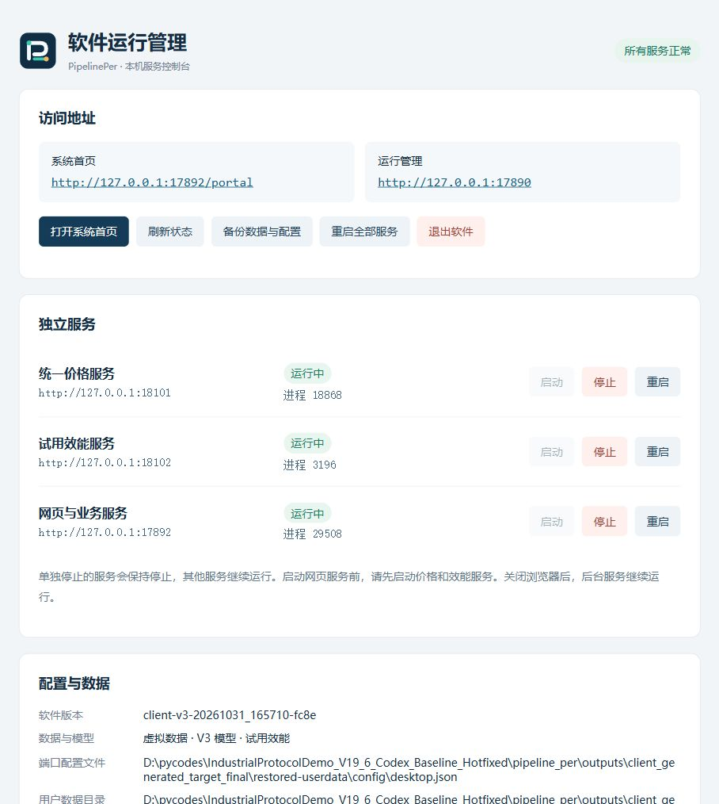
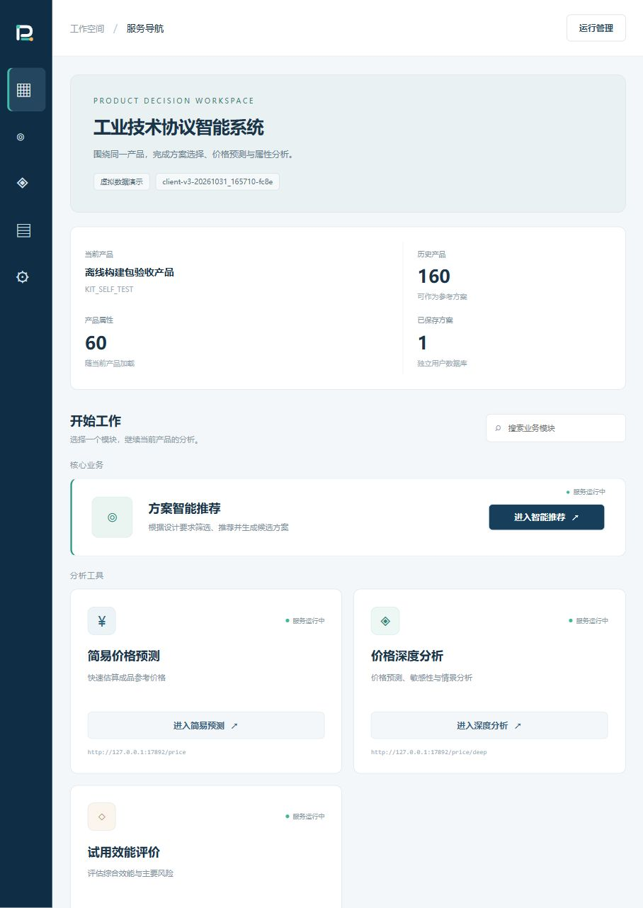

# 甲方离线开发包 R2 · 2026-10-31

已准备一个完整的“甲方本机数据 → 现有 Optuna V3 → HTTP 一致性验证 → product.exe 运行包”离线开发压缩包，并对**同一个 R2 ZIP**进行了解压、清空 PATH、真实训练、封装和启动测试。

**目标是 Windows 7 SP1 x64；实际测试宿主是 Windows 11 x64 build 26200。Win7 实机尚不可访问，因此该压缩包是 Win7 现场候选开发包，不是已完成 Win7 实机认证的正式发行。** 这个限制也写在包内“先读我”与清单中。

## 下载与身份

- [离线开发包及校验文件](https://github.com/RogerRuben/pipeline_per/releases/tag/client-build-kit-20261031)。
- 文件：`ClientBuilder_V3_Win7x64_20261031_R2.zip`。
- 大小：72,060,835 bytes，约 68.7 MiB。
- SHA256：`9263c3e2e5c23aa9376a757253f80af101f2cb66c17d739943860fa7ef9abba5`。
- 开发包构建源码：`0babb08`；后续提交为验收资料。
- [构建记录](audit/client_kit_20261031/kit_build.json)、[完整清单](audit/client_kit_20261031/KIT_MANIFEST.json)、[依赖与范围摘要](audit/client_kit_20261031/kit_summary.json)。

源码分支基于 P4.1 加固分支，保持独立 Draft PR。PR #1／PR #4 和 main 均未在本轮合并或改动。

## 包内入口

| 文件／目录 | 用途 |
| --- | --- |
| `CHECK_ENVIRONMENT.bat` | 校验完整性、包内解释器、依赖与数值自检 |
| `CHECK_INPUT.bat` | 检查产品表、英文字段与训练输入 |
| `SELF_TEST.bat` | 用内置虚拟表执行 40 次真实 V3 训练、验证、封包、实际 EXE 启动 |
| `TRAIN_AND_PACKAGE.bat` | 用甲方本地数据执行正式操作流程；默认 300 次试验，配置可调整 |
| `REPACK_LAST.bat` | 复用上次已验证模型重新封包，不再次训练 |
| `settings/project.json` | 产品编码、名称、输入路径和数据类别 |
| `settings/v3.json` | V3 训练配置，显式锁定引擎，默认不自动复用其他项目历史 |
| `settings/desktop.json` | 四个服务的初始端口和自动打开浏览器设置 |
| `runtime/python38` | 包内 CPython 3.8.10 x64 与完整锁定训练依赖 |
| `bootstrap` | 已预编译的原生 product.exe、图标、来源指纹与 PE 记录 |
| `project` | 已封存的程序、V3 源码和验证封装工具，现场不需要 Git |
| `input`／`examples` | 可替换产品表／保留的虚拟示例 |
| `deliverables` | 验证成功后产生的新运行 ZIP、SHA 与回执 |

常规现场流程不需要安装 Python、PyInstaller、Git 或 C 编译器，也没有云训练或自动上传步骤。Win7 中文可编辑 JSON 和“先读我.txt”采用 UTF-8 BOM；BAT 使用系统 `chcp.com` 绝对路径，不依赖 PATH 中有系统命令。

## 原生启动入口与图标

本包复用预编译的 x64 Win32 GUI 入口，按 PE 子系统 **6.1** 生成，显式普通用户权限和 Win7 supportedOS manifest。入口仅导入 Kernel32／User32，不使用 PyInstaller 引导器或额外 CRT；它启动包内解释器，等待监督器退出，服务仍由 Job 与父进程监视管理。

[PE 与图标检查](audit/client_kit_20261031/pe_icon_checks.json)确认 GUI x64、6.1 子系统、Win7 manifest、7 个图标尺寸；[构建来源与系统 API 列表](audit/client_kit_20261031/native_bootstrap.json)已留档。这些是静态检查，不等同于 Win7 已实测。Python 与数值扩展仍需目标机具备相应系统补丁／运行库。

图标为原创的深蓝底、白色 P、青绿／金色流水线节点，源码 SVG 与多尺寸 ICO 同时提供，Portal 与 EXE 共用视觉标识。

## 外部端口与单服务管理

端口样例值只存在于 JSON 配置。开发包通过 `settings/desktop.json` 指定运行包初始端口；运行后以用户数据目录 `config/desktop.json` 为准。以后改外部文件、退出并重新启动即可，无需修改代码、训练或重新封装。

运行管理显示实际地址、配置路径、端口和各进程。即使浏览器没有自动打开，也可通过运行包“访问地址.txt”、`SHOW_ADDRESSES.bat` 或用户目录 `runtime/access.txt` 找到地址。端口占用明确失败，不静默换端口。

价格、效能、网页可分别启动、停止、重启，主动停止后不会自动恢复，其他进程保持运行。重启保留服务地址，状态可在 Portal 实时反映。网页服务首次启动依赖价格和效能已启动。

本机 17891 已有现有进程监听，预览启动如实失败。仅把测试实例外部 JSON 的网页端口改成 17892 后成功启动；最终截图即使用该配置。没有改程序或停止占用 17891 的其他进程。

## 最终 ZIP 的实际测试

| 验证 | 结果与原始证据 |
| --- | --- |
| R2 ZIP 解压后离线入口 | [11/11 通过](audit/client_kit_20261031/kit_acceptance.json)：中文空格路径、无 Git 检出、空 PATH、BAT 环境／输入检查、真实训练、HTTP 验证、EXE、重封装、错误数据类别和源文件篡改拒绝 |
| 真正训练 | 实际完成 Optuna V3 40 次试验，160 行／60 属性；[训练报告](audit/client_kit_20261031/training_report.json) |
| 实际生成 EXE | [启动与三入口预测检查](audit/client_kit_20261031/delivery_smoke.json)通过 |
| 统一服务一致性 | [原生模型 API 报告](audit/client_kit_20261031/native_api_validation.json)通过，仍是虚拟数据模型，不作业务精度认证 |
| 只重新封装 | 全部训练产物 SHA 在重封装前后相同；生成新的运行 ZIP；见 [REPACK 日志](audit/client_kit_20261031/REPACK_LAST.bat_output.txt) |
| 正常 customer 操作分支 | [90 行／6 属性模拟 CSV 通过](audit/client_kit_20261031/customer_path_simulation.json)，`TRAIN_AND_PACKAGE --quick` 生成并启动另一模型，三入口均为 10.509138 万元；明确是流程模拟，不是真实甲方数据 |
| 单服务与外部端口 | [14/14 通过](audit/client_kit_20261031/individual_controls.json)，对最终开发包新训练生成的 EXE 执行；包括独立启停、地址不变、其他 PID 不变、主动停止保持、端口冲突拒绝 |
| 生成包的恢复／进程演练 | [18/18 通过](audit/client_kit_20261031/generated_runtime_exercise.json)，使用生成包自己的解释器，包含保存、备份、独立还原、重启、崩溃清理和完整性；本轮未传旧包回滚参数，因此不计两项旧包回滚 |
| 配置及离线来源边界 | [5/5 通过](audit/client_kit_20261031/configuration_tests.txt) |
| 已有桌面数据保护 | [16/16 通过](audit/client_kit_20261031/desktop_tests.txt) |
| Python／表格兼容性 | [18/18 通过](audit/client_kit_20261031/portable_tests.txt) |
| Portal 与工作台回归 | [通过](audit/client_kit_20261031/portal_regression.txt) |

本次完整恢复演练的 Top10 单次为 **4.843 秒**，60 属性。测试说明的是本机执行链路与一致性；不把它作为 Win7 性能承诺。不同字段数量的正例验证程序没有绑定示例的 60 个字段。

生成的第一个示例模型 SHA 为 `18be582d473cfb2a39ddd7425b6689e25d9d63754dfafdf446598e598f37dfef`，由本轮解压后的包实际训练产生，并非直接复制上一轮的模型。工作区中的 AutoML V3 和价格／效能算法源文件相对 P4.1 无更改。

## 实际页面检查

最终截图来自 R2 包训练并封装的程序，在已恢复数据目录中运行。Portal 显示真实产品名、160 条历史产品、60 个属性和 1 个保存方案；搜索“深度”只显示相应模块。未启用登录时隐藏退出按钮。

浏览器实际点击单独重启价格服务，价格 PID 从 18868 变为 29984，效能 3196 和网页 29508 保持不变，价格地址仍为 18101。随后单独停止价格服务，Portal 显示停止并禁用价格入口；从管理页启动后恢复正常。[浏览器记录](audit/client_kit_20261031/browser_checks.json)

## 分发与现场门槛

[分发扫描](audit/client_kit_20261031/distribution_scan.json)检查 2,790 个文本文件，指定凭据模式零命中，ZIP 无 SQLite、`.env` 或 Git 目录，解释器 `_pth` 使用包内相对路径；这不是完整安全审计。包中只有批准的虚拟示例，甲方后续的原始表、模型、日志及生成交付包均留在甲方机器。

现场先运行 `CHECK_ENVIRONMENT.bat` 和 `SELF_TEST.bat`；通过后替换真实表、填写产品信息和 `data_kind=customer`，再构建。此包包含现有试用效能快照，不替代正式泵 V13。代码签名、实际 Win7 引导器／DLL／Job／浏览器操作，以及甲方业务准确率验收仍待完成。
