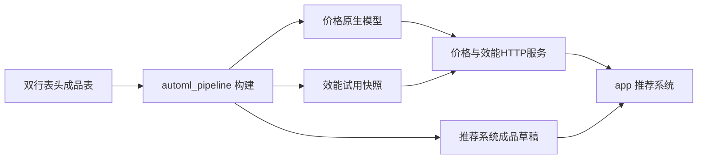

# 源码目录与产物边界

2026-10-20整理，2026-10-23加入AutoML V5。推荐系统基准仍为V19.6.14，保留V2/V3/V4；已有模型类路径及成品业务格式保持原有约定。

## 两部分源码

```text
app/                       推荐系统后端、前台及业务数据管理
run_app.py                 推荐系统启动
automl_pipeline/           当前快速建模和成品构建实现
  configs/                 V2/V3/V4默认训练配置
services/
  price_service/           价格推理、原生模型导出、可复用训练核心
    optuna_v2/             提供版本核心、V2搜索、V3搜索及编码
    optuna_v4/             V4搜索、划分、指标、缓存、融合及推理成员
    optuna_v5/             V3保留基线、受约束融合、条件搜索及检查点
  effectiveness_service/   效能推理与已有专家工程产物适配
tools/                     环境、交付、验证、历史实验和兼容入口
tests/                     推荐、模型、流水线与打包测试
docs/                      当前使用说明、部署说明及历史设计
```



`app`是业务消费者，`automl_pipeline`是训练与构建者；共享服务和解析模块不重复复制。专家效能工程及其正式产物有独立边界，自动构建的效能快照是试用基线。

## 旧入口兼容

当前实现集中在`automl_pipeline/`：`product_pipeline`、`product_effectiveness_bootstrap`、V2/V3/V4/V5配置入口、输入适配、V4/V5训练导出适配、模式与版本管理。

`tools/`下的同名文件保留转发，旧BAT无需更改。导入新旧路径得到同一模块对象，因此针对旧模块的测试替换仍作用于实际实现。价格原生推理类仍位于原`services.price_service.*`路径；没有通过移动模型类破坏旧pickle。

源码使用`python -m automl_pipeline`，离线包保留`MODE_MENU/CHECK_INPUT/RETRAIN/START/EXPORT`操作习惯。打包文件清单与保存模型导出已加入新目录，代码指纹读取实际实现文件。

## Git与本机资产

| 纳入Git | 本机状态 / 独立交付 |
| --- | --- |
| 推荐系统、流水线、服务源码 | Python环境、wheel、第三方压缩包 |
| 默认配置及虚拟测试样本 | 真实成品输入、专家现场配置 |
| 测试、使用说明、算法来源记录 | SQLite运行数据库及备份 |
| 构建与验收脚本 | outputs、logs、exports、deliverables中的产物 |

已有离线包不因目录整理被改写。源码提交与旧交付ZIP各自有版本；重新打包时同时携带兼容入口及新实现目录。需要重现离线包验收时，应另行准备固定环境和对应旧资产。
