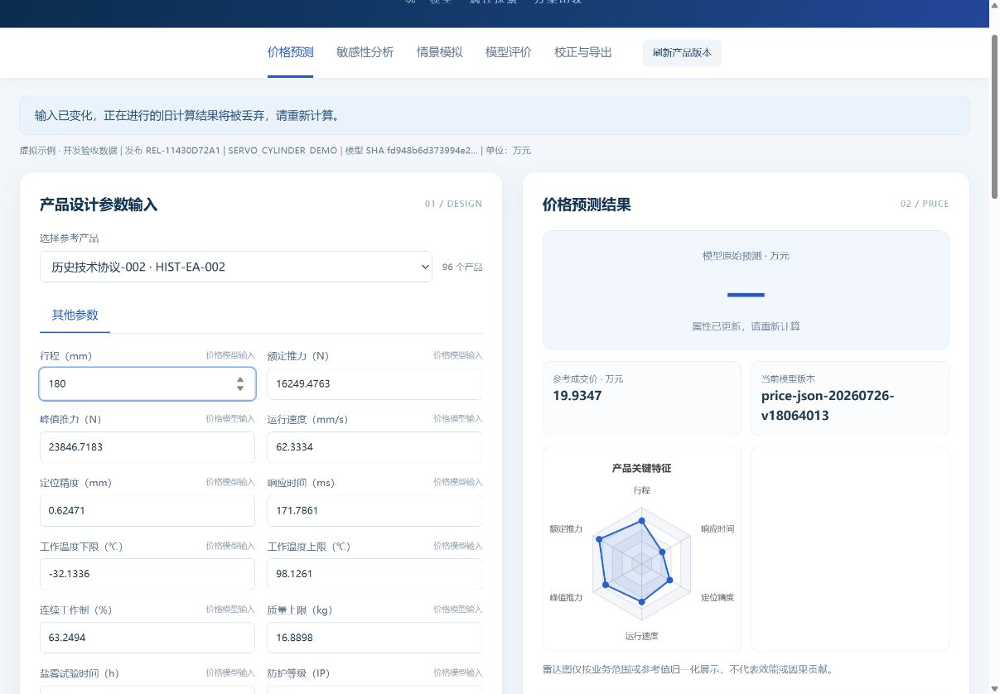

# P1-2.1 审阅修复与验收

对应PR #1的COMMENT Review 5714442857。运行代码提交：**c420fc76d7858308d2880dfd97b833e7aaeededa**。本版只修复兼容性边界，不扩大页面功能，不改外观、AutoML V3算法或既有价格服务调用链，不合并main。

## 1. Top10覆盖50及更多字段

取消49字段拒绝条件。所有可计算字段按固定合法采样规则生成作业，每批最多99采样点加1条重复基准；单个HTTP批量接口仍限100。仅保存跨批次的标量结果，全量参数字典最多保留一批，避免字段数增加时的平方级内存增长。

整次分析共用原有30秒预算和身份：发布、业务快照、模型版本/SHA/实例、价格归一化配置。每批沿用DeepPriceAnalysis单批保护；整个请求额外保留只读SQLite连接的data_version，捕获批次间修改后恢复的情况；最后再复查完整身份和基准价格。任一批失败、超时或版本变化，整次作废，不返回部分曲线或缓存result_id。

保留明确资源限制：单次最多10000采样点；超出返回413，用户可缩小字段范围。这是总工作量限制，不是49字段限制。返回sample_count和batch_count，便于审查。Top10依然按合法采样范围内最大绝对价格变化率排序，不能解释为因果重要度。

新增真实HTTP原生虚拟模型回归：50和60字段分别全量计算，Top10正确包含最后10个高权重字段，每个批次不超过100。另覆盖后续批次模型替换、业务数据修改后恢复、全局超时，全部拒绝部分成功。

## 2. 校正规则适用范围

confirmed规则现在必须声明：

- applicability：product_code、model_version、price_model_sha256、price_output_signature，均为明确身份，不支持通配产品或模型。
- price_basis：kind=model_unit_price、base_year、reference_quantity、description，必须与规则基年/基准数量一致。业务负责人须确认该具体模型输出是此口径下的单价。

实际校正先核验缓存原始预测与规则适用范围，再校验当前发布/模型。范围不匹配时状态接口返回not_configured、计算返回409；旧的confirmed但无绑定规则返回配置不可用503，不能继续跨产品套用。confirmed=false的示例仍为未配置。

前端提交可选rule_sha256，服务端校验规则内容变化，原API调用格式保留兼容。结果仍记录完整规则与SHA；PPI/弹性未获得真实业务确认时不启用。更新示例见config/deep_price_adjustment.example.json。

价格基准的业务正确性由该模型/规则的审批保证，代码只验证声明与身份匹配，不能替代正式V3模型和业务价格基准验收。

## 3. 输入未失焦时的异步保护

主字段同时监听input和change。每次键入立即递增epoch、清空旧价格/分析/导出；输入变化后，旧的成功响应和错误响应都不能覆盖当前界面。

真实浏览器复测在独立虚拟环境令预测响应延迟4秒。提交行程200后，保持输入框焦点连续键入18→180；确认请求仍在进行。旧响应返回、预测按钮恢复后：焦点仍为field_stroke_mm，价格为“—”，导出禁用且无新增导出选项。随后重新预测180，才显示20.9329万元并启用导出。见 [DOM断言记录](audit/p1_2_1/browser_input_race.json) 和截图；未通过失焦来触发change。

## 4. 验证结果与后续门槛

Python3.8.10 x64环境下：新增6项审阅回归、原20项综合HTTP、18项兼容、价格导出、Portal/工作台和完整旧流水线45项检查均通过。174项来源/结构检查通过。命令、环境、源码树和模型SHA见 [机器报告](audit/p1_2_1/p1_validation_report.json)，全部输出位于同目录。超时负例会主动中止HTTP等待，Windows服务端可能记录预期的ConnectionResetError；该负例断言504且无部分结果，不属于测试失败。

P4前置项继续保留：校正规则当前仍读取app.root/config；EXE阶段必须迁移到独立userdata，并验证只读安装目录、升级与备份恢复。本版不提前改安装/持久化目录或打包。

下一阶段转入正式V3模型集成验收：选定真实产品表/既有V3导出包及训练环境，验证字段、单/批预测、模型身份、真实指标/重要度/解释元数据和异常处理。当前全部证据仍为虚拟数据/模型，未声称正式V3、Win7或product.exe已通过。
