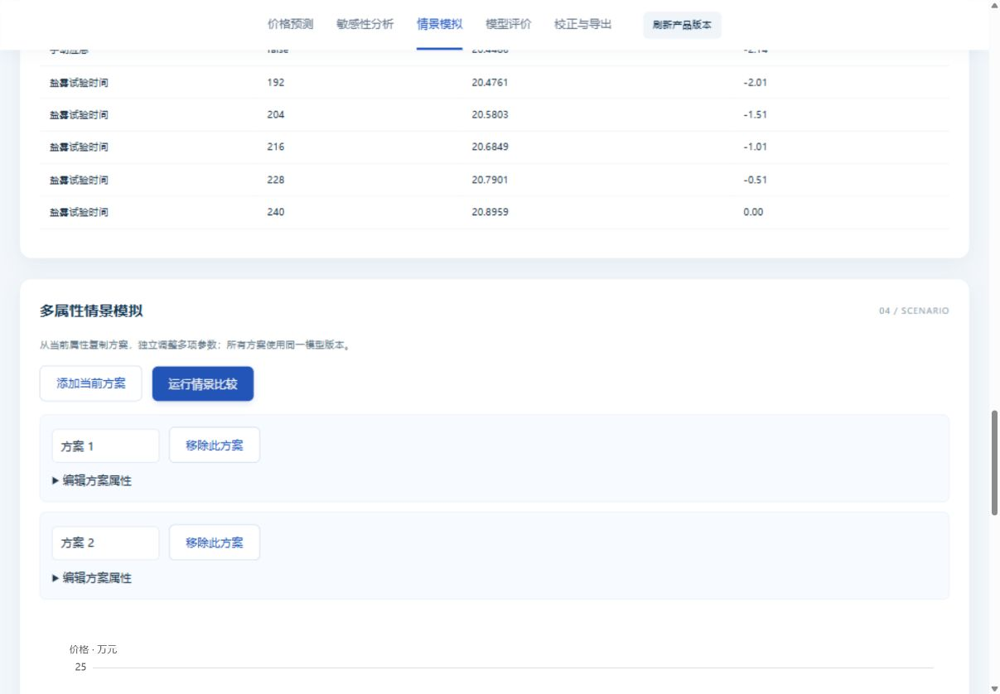

# P1-2 综合功能验收 · 2026-10-30

最终测试提交 **188a15d3b83630b67d4a291b8c543d70e02f5657**，源码树哈希、解释器、依赖和模型SHA见 [机器报告](audit/p1_2/p1_validation_report.json)。此前综合实现为8ebe6c2；188a15d只修订布尔选项显示/回填，后端未变。后续证据提交不改变运行代码。

## 自动验收

| 检查 | 结果 |
|---|---|
| 深度分析综合HTTP测试 | **20/20通过**（含原13项和新增7项：敏感性/情景、零基价、真实指标、校正规则、会话/过期/退出隔离、CSV公式保护） |
| Python兼容测试 | **18/18通过**，包括Optuna导入和spawn |
| 价格原生导出回归 | 通过，原三模型集成和权重回退保持一致 |
| Portal／工作台回归 | 通过，导航与当前启动委托关系、工作台字段和值边界 |
| 完整旧流水线 | **45项检查通过**，包括已修复的生成批次查看、混合显示、属性重算、保存以及HTTP生成批次/详情 |
| 来源/结构 | **174项通过**；新增与修改Python代码通过3.8语法检查 |
| API契约 | 14个实际路径、164处内部引用可解析；未使用完整OpenAPI规范验证器 |
| 来源扫描 | 已跟踪源码按已知令牌/私钥模式扫描无命中；文件数量与限制见source_scan.json |

环境：Python3.8.10 x64、Optuna3.6.0、NumPy1.19.5、SciPy1.5.4、sklearn0.24.2，Windows宿主10.0.26200。测试使用可信生成的虚拟LinearFixture及已有虚拟JSON产物，**不是正式V3模型，也不是Win7实机验收**。

完整命令输出、源码树哈希和模型身份均在[audit/p1_2](audit/p1_2/)；full_pipeline_test_report.json记录45项检查明细。推荐生成修复只统一请求情景默认值与fingerprint，不改生成搜索或排序算法。旧测试中绑定表/API版本/BAT文本断言已更新为当前真实契约，未恢复退役接口，也未删除失败路径来掩盖问题。

## 实际网页交互

使用本机独立虚拟环境，从Portal进入深度页，选择历史产品002，将行程改为200，得到20.8959万元。随后执行单参数曲线、Top10、添加两个情景，并将第二情景的行程改为180、推力改为15000，得到20.5219万元。浏览器实际下载CSV/TXT。

| 情景 | 行程mm | 额定推力N | 网页/导出万元 | 推荐价格HTTP通路重放万元 |
|---|---:|---:|---:|---:|
| 方案1 | 200 | 16249.4763 | 20.8959 | 20.8959 |
| 方案2 | 180 | 15000 | 20.5219 | 20.5219 |

误差小于1e-8，[对照记录](audit/p1_2/ui_api_consistency.json)与[网页下载CSV](audit/p1_2/browser-scenario-export.csv)、[TXT](audit/p1_2/browser-scenario-export.txt)可交叉核验。实际截图展示虚拟模型真实提供的test_metrics；无重要度时明确暂无，无校正规则时明确禁用。确认规则的计算分支在隔离API测试中使用显式TEST-ONLY数据验证，没有将试验PPI放入演示配置冒充正式规则。

还验证了：切换产品清空价格且禁用旧结果导出；刷新可重新读取版本；布尔0/1正常显示为是/否；桌面双列/窄屏布局（浏览器实际CSS宽度见browser_validation.json）无正文横向溢出；浏览器控制台无错误。临时视口设置已恢复。登录401、异源403、模型故障503、版本冲突409和会话越权/过期404由真实HTTP测试覆盖。

## 截图与演示

- [分步交互回放](audit/p1_2/interaction-replay.html) / [动图回放](audit/p1_2/interaction-demo.gif)：由实际截图组成，不是实时录屏。
- [Portal入口](audit/p1_2/01-portal.jpg)、[产品修改与预测](audit/p1_2/03-edited-product-prediction.jpg)、[单参数](audit/p1_2/04-single-sensitivity.jpg)、[Top10](audit/p1_2/05-top10.jpg)、[多属性情景](audit/p1_2/06-scenario-comparison.jpg)、[模型指标](audit/p1_2/07-real-model-metadata.jpg)、[导出/未配置规则](audit/p1_2/08-export-and-unconfigured-rule.jpg)、[窄屏](audit/p1_2/09-mobile-layout.jpg)。

本轮满足虚拟数据下的综合网页功能验收。正式产品表/V3依赖、真实业务校正规则、Win7及EXE仍为独立门槛；main保持未合并。原README的未提交用户编辑保持原样。
