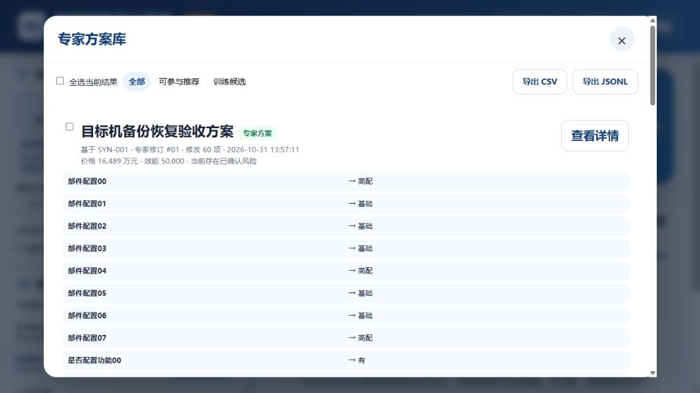
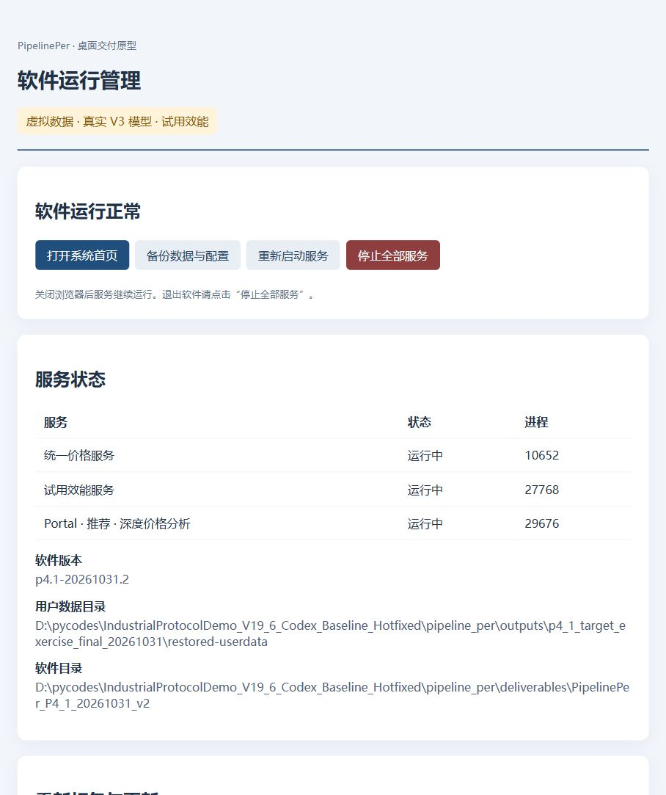

# P4.1 · Windows 7 兼容与交付加固

本轮已将 PR #3 合并至 `codex/p1-price-gateway`（`8a656eb`），PR #1 继续 Draft，`main` 仍为 `fbe13fe`。随后在 `codex/p4-1-delivery-hardening` 开发 P4.1。

**交付加固与恢复演练已在 Windows 11 通过；Windows 7 实机验收仍待目标环境。** 本机没有发现可用 Win7 虚拟机工具或已提供的目标机连接。现有 PyInstaller 5.13.2 的官方支持范围及 Win7 嵌套 Job 限制没有因为这轮本机测试而消失。本轮没有更换引导器或放宽 Job 清理机制。

## 交付包

- [P4.1 原型预发布](https://github.com/RogerRuben/pipeline_per/releases/tag/p4-1-hardening-20261031)。
- 文件：`PipelinePer_P4_1_20261031_v2.zip`，72,251,184 bytes，约 68.9 MiB。
- ZIP SHA256：`0f58b113fc4c40412f548ed2d4c457c53eb3109650d817ec21500ca462b12fe4`。
- 运行代码／实际 EXE 基线：`e6e9b1a`；其后为测试工具及审计资料更新。
- 包版本：`p4.1-20261031.2`；[完整清单](audit/p4_1_20261031/PACKAGE_MANIFEST.json)含 2,529 个文件。
- [操作说明](P4_DESKTOP_USAGE.md)、[目标机验收说明](P4_1_TARGET_MACHINE.md)、[构建记录](audit/p4_1_20261031/build_report.json)。

本轮继续使用批准的虚拟表训练所得真实 V3 pickle 和试用效能。没有重新训练模型，`app`、`automl_pipeline` 与 `services` 相对合并后的 P4 零变更。交付物未代码签名，不作为正式 Win7 发行版或业务准确率认证。

## 同产品换模契约

构建器使用交付解释器加载真实 pickle 并预测，再从实际模型 Schema 和业务发布包生成 sealed `release/delivery_contract.json`，并将其纳入包文件哈希清单。[实际契约](audit/p4_1_20261031/delivery_contract.json)包含：

| 检查层 | 内容 |
| --- | --- |
| 模型 | feature_order、字段 ID、类型、单位、必填、缺失策略、枚举取值／编码、解析与来源 |
| 业务字段 | 类型、搜索类型、边界、必填、取值、特殊值、显示与模型映射 |
| 已发布业务 | 恰好一个激活版本；产品一致；现场字段与该发布快照一致 |
| 接受状态 | 本机已接受的 release_id、发布内容指纹、输入绑定指纹与模型 Schema 指纹 |
| 价格基准 | 模型单价、原始输出单位和尺度、规范化为万元；等价配置先规范化 |

启动器在创建 Application／Store 之前，以只读 SQLite 检查已有数据。字段契约一致的重训模型可以更新模型 SHA／版本；字段、编码、价格口径或已接受发布身份变化则拒绝，等待显式迁移。模型权重和学习统计不要求完全相同，否则无法支持真正的重训更新。

已有 P4 安装没有上述接受状态，因此不能仅凭产品编码自动认可。构建 `--legacy-package` 先完整校验指定前版，要求价格模型和业务包 SHA 均与当前包一致，才将其加入许可前版列表。已发布 P4 v2 的接续通过实际 EXE 测试。后续保存方案和历史数据不因启动而重新导入。

## 独立恢复与回退

P4.1 新备份采用版本化清单，包含 SQLite 一致性快照、JSON 配置、安装和接受契约状态。运行控制令牌、日志、外置模型及导出文件不在恢复范围内。

```powershell
.\product.exe --restore "D:\Backups\backup-xxx.zip" --data-dir "D:\PipelinePerRecovered" --report "$env:TEMP\restore.json"
.\product.exe --data-dir "D:\PipelinePerRecovered"
```

恢复只接受新的空目录。它先检查路径、重复条目、链接、大小预算、文件清单与 SHA，再检查 SQLite 和交付契约，最后持锁发布文件。已有数据库和配置不会被覆盖。发布过程有中断标记；恢复意外中断或已初始化安装丢失数据库时，正常启动拒绝重新播种默认数据，要求从备份恢复。旧 P4 无清单 ZIP 不被当作新版备份静默接受，需保留原包另行核验。

实际演练通过 API 保存“目标机备份恢复验收方案”，备份后还原到独立 `restored-userdata`，重新启动并检查完整方案、规则文件字节、预测、SQLite 完整性；再用原 P4 v2 目录启动该恢复库回退，最后返回当前 P4.1。

[恢复对照](audit/p4_1_20261031/restore_comparison.json)显示以下五张表的全量记录相同：`products`、`parameter_definitions`、`agreements`、`saved_schemes`、`product_releases`。另附[恢复前记录摘要](audit/p4_1_20261031/userdata_comparison.json)、[恢复后记录摘要](audit/p4_1_20261031/restored-userdata_comparison.json)、[备份清单](audit/p4_1_20261031/backup_manifest.json)及[实际恢复命令结果](audit/p4_1_20261031/restore_command.json)。





## 验证结果及范围

| 检查 | 结果／证据 |
| --- | --- |
| 桌面边界 | [16/16 通过](audit/p4_1_20261031/desktop_boundary_tests.txt)：兼容／不兼容换模、口径和发布变化、损坏库、旧版接续、备份恢复、路径／哈希拒绝、禁止覆盖、单实例、控制端保护、中断及数据库丢失 |
| P4 → 最终 P4.1 | [23/23 通过](audit/p4_1_20261031/legacy_upgrade.json)，实际旧包数据升级，拒绝错误价格口径和激活发布版本时 SQLite 无写入 |
| 两个不同真实 V3 模型间升级 | [24/24 通过](audit/p4_1_20261031/native_model_upgrade.json)：原模型 `260f18…` → selected-split 模型 `37df47…`，兼容 Schema 下数据保留、新模型身份与换模后三入口价格一致性 |
| 可移植目标机脚本 | [20/20 通过](audit/p4_1_20261031/target_exercise.json)，实际执行最终 EXE，含保存、备份、恢复、重新启动、回退和返回当前版本 |
| 页面 | 恢复后的方案库、详情、版本和运行目录已实际打开并截图；页面业务代码没有改动 |
| 分发检查 | [1,298 个文本文件指定模式扫描](audit/p4_1_20261031/distribution_scan.json)零命中，ZIP 无数据库、`.env` 或 Git 目录；不是完整安全审计 |

两份模型均来自上一阶段相同虚拟输入的真实 V3 构建，SHA 分别为：

- `260f18f43e82dbf3b3670e486a4ba6fa3884713015c517f279930ea5c7ea3dab`
- `37df47be3e870494a3b6cb342b5b49c7446dd886cb23706e15a41ded243da472`

最终恢复脚本在 Windows 11 上的 Top10 为 **4.781 秒**，60 字段、350 个样本点、4 批。三个价格入口在原模型下均为 **16.489382 万元**，恢复后保持一致。两组升级验收曾并行执行，启动耗时受到文件校验和主机负载影响；这些观测不构成目标 Win7 性能承诺，也不宣称算法得到性能优化。

更换为 `37df47…` 后，三个入口均为 **16.388382 万元**。这是另一个模型的预测结果；一致性检查比较同一模型下的推荐、简易与深度入口，不要求不同模型给出同一价格。

一次边界测试在收到 HTTP 停止应答后立即断言后台事件，暴露异步测试竞态。测试现等待停止事件完成，最终 16 项通过；[原始失败记录](audit/p4_1_20261031/desktop_boundary_initial_async_assertion.txt)保留。修正只涉及测试断言，不改变已构建运行代码。

## Windows 7 门槛仍未解除

包内新增 `TARGET_CHECK.bat` 和无需系统 Python 的可移植检查器。在目标 Win7 SP1 x64 上执行可收集引导器／DLL、服务进程、模型推理、Top10、故障恢复、独立恢复／回退和退出清理的实际证据。所有数据隔离，不自动上传结果。

本机为 Windows 11 家庭版 x64 build 26200。已检查 PATH、常见 VirtualBox／VMware／QEMU 安装位置与相关服务，未发现可用目标环境。[环境记录](audit/p4_1_20261031/environment_availability.json)。脚本在本机明确给出 `gate=not_a_win7_target_machine`、`win7_validated=false`。Win7 上自动检查通过后也仍须完成目标浏览器人工操作；脚本不自行签发 Win7 认证。

[PyInstaller 5.13.2 官方要求](https://pyinstaller.org/en/v5.13.2/requirements.html)为 Windows 8 或更新版本；[Microsoft Job Objects](https://learn.microsoft.com/en-us/windows/win32/procthread/job-objects)说明 Win7 不支持嵌套 Job。收到目标机器的真实失败日志后，再决定是否调整引导器、依赖或进程封装方案，并完整复验。代码签名和正式发布仍属于后续门槛。
