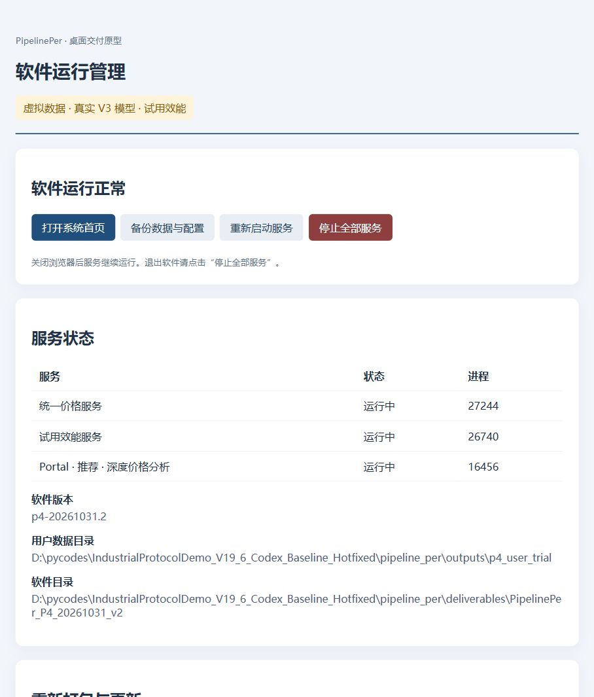
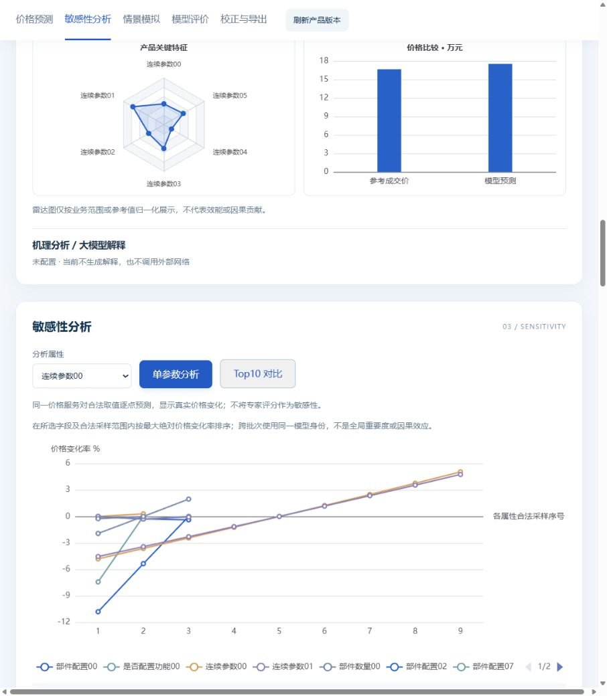

# P4 product.exe 原型封装验收 · 2026-10-31

P4 桌面原型已完成并在本机 Windows 11 家庭版 x64（10.0.26200）实际执行。交付物是 PyInstaller onedir 形式的窗口化 `product.exe`，内含独立模型解释器、既有 Portal／推荐／深度价格分析页面、真实 V3 pickle 与试用效能快照。

本轮使用上一轮批准的**虚拟产品数据训练所得真实 Optuna V3 模型**；没有新增网页分析功能、没有修改 V3 算法、没有启用可加属性混合定价。Windows 7 实机验收和真实业务准确率仍未完成，不能将此包标记为正式 Win7 交付版。

## 交付与源码

- 开发分支：`codex/p4-product-exe`，基于 `codex/p1-price-gateway` 合并提交 `6ca5588`。
- 桌面框架源码：`bf22bd8`；模型类封装修复与交付包源码：`31edafe`。
- 完整交付包：`PipelinePer_P4_20261031_v2.zip`，72,216,593 bytes，约 68.9 MiB。
- ZIP SHA256：`51551b41c832a7e237f61069ffd4fad1aaa568714c0273cb46550de215f809b5`。
- 包版本：`p4-20261031.2`；2,523 个不可变文件，清单随包交付。
- [原型预发布下载](https://github.com/RogerRuben/pipeline_per/releases/tag/p4-prototype-20261031)。
- [操作说明](P4_DESKTOP_USAGE.md)、[完整文件清单](audit/p4_20261031/PACKAGE_MANIFEST.json)、[构建记录](audit/p4_20261031/delivery_build.json)。

交付采用真实 EXE 管理入口加内置 CPython 3.8.10 模型运行时。用户无须安装 Python 或联网。EXE 没有代码签名；SHA256 用于完整性校验，不等同于发行方签名。无需把大体积二进制压入 Git 历史，ZIP 与校验文件作为仓库预发布附件提供。PR 保持 Draft，未合并到 P1，`main` 与 PR #1 的 Draft 状态均保持不变。

## 已实现的行为

| 范围 | 行为 |
| --- | --- |
| 单击启动 | 启动器校验包完整性，依次启动价格、试用效能和业务网页服务，健康检查通过后打开 Portal |
| 进程所有权 | 通过 Windows Job 持有本次启动的进程；命令操作使用实例令牌，不根据旧 PID 文件结束进程，不按进程名批量终止 |
| 服务监督 | 进程退出或连续三次健康检查失败后重启整组服务；60 秒内最多自动重启三次，之后保留错误状态及管理页，允许人工重启 |
| 单实例 | 同一用户目录的重复启动复用现有实例；崩溃后操作系统释放文件锁，陈旧状态文件不会阻止重新启动 |
| 用户数据 | 默认 `%LOCALAPPDATA%\PipelinePer`；可显式指定独立目录；SQLite、配置、日志、导出、备份均在其中 |
| 数据初始化 | 只在数据库不存在时导入业务发布包；已有数据库先检查完整性和当前产品，拒绝损坏数据或错误产品包，不重新导入、覆盖或激活默认数据 |
| 校正规则 | 从用户目录 `config/deep_price_adjustment.json` 读取；已有规则及价格单位配置保留，原有产品／模型／价格基准绑定仍生效 |
| 更新与回退 | 新版本解压到新目录，使用同一数据目录启动；版本变化前自动备份 SQLite 和 JSON 配置；数据 Schema 不匹配则拒绝启动，等待明确迁移 |
| 运行管理 | Portal 增加“软件运行管理”入口，可查看三个进程、打开业务页、在线备份、重启和停止；关闭浏览器后后台服务继续运行 |
| 模型复用 | 复用封装前的 pickle 和 SHA；价格服务仍为 HTTP-only，所有业务入口共用该服务；启动和重新打包均不训练 |

三个服务和运行管理仅绑定 `127.0.0.1`，端口由操作系统动态分配。运行管理写操作验证实例令牌、Host、Origin 和跨站请求标志。应用端既有认证机制保持原样，本地原型不默认启用登录。

## 实际冻结包验收

验收工具 `tools/verify_product_exe.py` 复制包至“中文 空格路径”，清空 PATH，重定向 LOCALAPPDATA 至全新隔离目录，**实际启动交付 EXE 和包内 pythonw.exe**。这不是直接运行源码的替代测试。

[20 项验收原始报告](audit/p4_20261031/frozen_exe_acceptance.json)全部通过：

| 项目 | 结果 |
| --- | --- |
| 真正的 PE x64 / GUI 子系统、包完整性 | 通过 |
| 默认独立用户目录、3 个实际服务进程 | 通过 |
| 无系统 Python 路径、中文和空格目录 | 通过 |
| 重复启动复用现有进程 | 通过 |
| 60 个真实 V3 字段、HTTP 预测一致性 | 通过 |
| Top10 和 CSV 价格导出 | 通过 |
| 未配置校正规则明确拒绝计算 | 通过 |
| 在线 SQLite 与配置备份 | 通过 |
| 主动结束当前实例价格子进程后自动恢复 | 通过 |
| 手动重启保留数据库和配置 | 通过 |
| 强制结束启动器后无遗留子进程 | 通过 |
| 陈旧状态恢复、正常停止清理控制状态 | 通过 |
| v1 → v2 重新打包更新保留用户数据 | 通过 |
| 更新前自动备份、运行前后包文件未变 | 通过 |

数据保留通过隔离 SQLite 中的“用户方案”标记、配置文件 SHA256 和数据库完整性共同检查。更新测试使用两个独立封装目录及不同版本号，未通过覆盖目录伪装更新。替换后的模型仍保持同一个模型 SHA。

| 观测值 | 实测 |
| --- | --- |
| 冷启动至全部服务就绪 | 29.812 / 15.343 / 28.546 秒 |
| Top10 | 10.422 秒；60 字段、350 样本点、4 批 |
| 价格进程退出后的整组恢复 | 12.500 秒 |
| 深度分析 / 简易预测 / 推荐的同输入价格 | 均为 16.489382 万元；差值 0 |
| 模型 SHA256 | `260f18f43e82dbf3b3670e486a4ba6fa3884713015c517f279930ea5c7ea3dab` |

本次为单机少量观测，冷启动包含文件校验、杀毒扫描和初始数据导入等开销，不代表各目标机器的性能承诺。Top10 在本轮 30 秒预算以内；当前实际集成成员为 Lasso 与 Ridge 两个，不能将结果宣称为六个活跃模型的吞吐测试。

## 其他验证与实际页面

- [7 项桌面边界测试](audit/p4_20261031/desktop_boundary_tests.txt)通过：目录隔离、文件篡改、保留已有数据／规则、错误产品和损坏数据库、在线备份、单实例锁、管理端请求保护。
- [已有功能回归](audit/p4_20261031/regression_report.json)全部通过：断开连接 5 项、评价元数据 3 项、审阅回归 8 项、综合 HTTP 20 项、Python 兼容性 18 项、动态模型与 Portal 回归、旧流水线 45 项检查。该组使用既有测试模型，不替代上表真实 V3 冻结包测试。
- 回归源码基线 `bf22bd8`；之后 `31edafe` 只修复打包依赖与内置模型推理自检，既有应用、价格算法和网页文件均无改动。
- [PyInstaller 编译日志](audit/p4_20261031/pyinstaller_build.txt)、[包内解释器真实推理日志](audit/p4_20261031/embedded_model_inference.txt)、[实际导出 CSV](audit/p4_20261031/frozen_exe_prediction.csv)已提交。
- 分发扫描检查 1,293 个文本文件，已知凭据模式零命中；ZIP 中没有数据库、`.env` 或 Git 目录。此为指定模式及路径检查，不是完整安全审计。[原始记录](audit/p4_20261031/distribution_scan.json)

浏览器实际操作基于 v1 与最终 v2 的真实 EXE 服务：Portal 进入深度分析、选择默认产品、修改 `numeric_00=50` 后显示 17.5357 万元，运行 Top10 曲线；运行管理页面备份成功、重启后显示新的网页地址、停止后显示退出提示。v2 的最终运行截图另附。截图没有通过重绘或模拟页面生成。

## 本轮发现及处理

初次封装缺少 V3 pickle 引用的 `optuna_v2` 特征编码和成员包装类，实际 EXE 加载失败。已将四份原始源码及 pandas／日期依赖完整纳入包内，不改动算法，并在封包前新增“使用交付解释器加载实际 pickle 并预测”的强制自检。失败的本地预览包不作为交付附件发布。

## Windows 7 尚待实机验收

CPython 3.8.10 与数值依赖版本已锁定，但 [PyInstaller 5.13.2 官方要求](https://pyinstaller.org/en/v5.13.2/requirements.html)为 Windows 8 或更新版本。另据 [Windows Job Objects 文档](https://learn.microsoft.com/en-us/windows/win32/procthread/job-objects)，Win7 不支持嵌套 Job。当前 Windows 11 运行成功不能证明这些目标环境差异已经解决。

目标 Win7 SP1 x64 机器应逐项记录：

1. 目标 OS、补丁、VC 运行库、浏览器版本及可写用户目录。
2. ZIP SHA 与解压后 `product.exe --verify --report <文件>` 结果。
3. 普通用户启动 EXE，无外部 Python、无需联网，三个服务和真实 pickle 成功加载。
4. Portal → 推荐／预测／敏感性／情景／导出全流程和价格一致性。
5. 重复启动、端口冲突、停止／重启、子进程崩溃和启动器被结束后的清理。
6. 修改数据及规则后退出、重新启动、换新版目录和回退，确认用户数据保留及备份可恢复。
7. 目标机器真实 Top10 耗时和 DLL／Job／浏览器异常日志。

在目标机器未验收之前，P4 的状态为“原型完成，Win7 交付门槛待验证”。若引导器或 Job 不兼容，需要调整构建工具链或启动环境后重新运行完整目标验收；不能靠文档将其标为已兼容。
