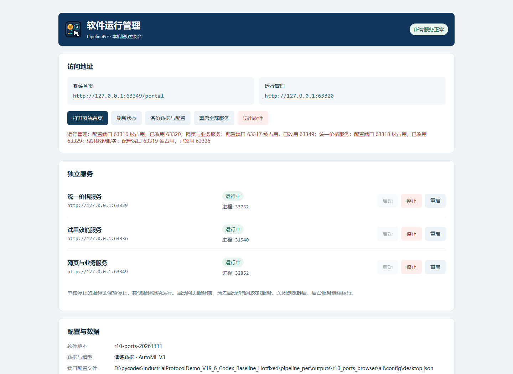

# R10 端口占用回退修复 · 2026-11-11

上版在配置端口被占用时直接绑定失败，隔离空闲端口验收没有覆盖此场景。本次不修改训练算法、模型或用户数据库。

- 优先原配置；绑定遇到 Windows 10048/10013 或 EADDRINUSE，直接向系统申请空闲端口并保持监听，不采用先探测后释放的方式。
- 自动选择时避开其他服务配置的端口，未占用配置照常使用。覆盖管理、网页、价格和效能四个端口。
- 实际地址写入 runtime/status.json、addresses.json、access.txt，管理页展示配置与实际端口；不会覆盖用户 config/desktop.json。
- 网页从运行状态同步价格、效能地址；单独重启遇到占用也能继续预测和效费比分析，不需要重启其他服务。模型库切换同样同步。
- 浏览器初次打开实际 Portal 地址；网页后续重启若更换端口，允许自动打开浏览器时会打开新地址。未就绪时不发布猜测的首页地址。
- 不终止占用端口的其他程序。其他原因导致的启动错误仍如实记录。

## 实测

Windows 11 x64，真实冻结 product.exe，虚拟演示模型。AutoML 六组：无占用、仅网页、仅价格、仅效能、仅管理、四个同时占用；并在单服务停止后占住原端口，再启动价格、效能、网页。51 个检查通过。DS 四个同时占用的 7 个检查通过。浏览器实际验证管理页提示与新首页地址；5 项端口单元测试、36 项桌面回归通过。

每组验证未占用端口保持不变、配置文件 SHA 不变、其他监听器保留、实际地址发布正确；深度纯预测、简易预测、推荐评价数值一致，效费比分析成功。单服务重新分配端口时，其余服务 PID 保持不变。

最终开发包已实际解压，5184 个不可变文件全部匹配 SHA；清空 PATH 后环境/输入检查通过，V3 与 DS 的 REPACK_LAST 均生成可运行 EXE，预测一致，模型没有重新训练。交付包均小于 100,000,000 字节。Win7 尚未实机验证。

## 使用

先在旧版管理页点击“退出软件”，确保退出后台实例；仅关闭浏览器不会退出软件。随后完整解压新版运行 ZIP，双击 product.exe。保留原用户数据目录与端口配置即可；再次双击可打开当前实际入口。

甲方开发包使用 CB10.7z，完整解压到 C:\，得到 C:\CB10，再按原流程训练/导入和封装。不能继续用旧 CB9S 引擎生成修复版。

校验摘要、测试结果与源码版本见 [manifest.json](audit/r10_20261111/manifest.json)。交付压缩包仅保存在本地，不上传 GitHub；main 不合并。
