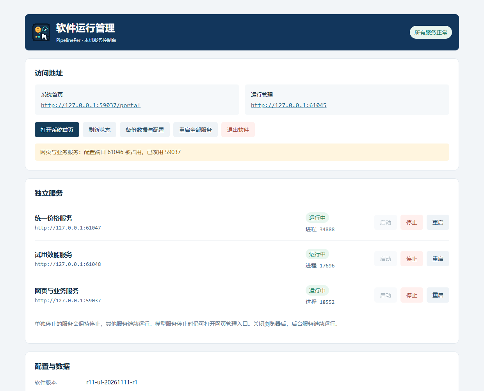
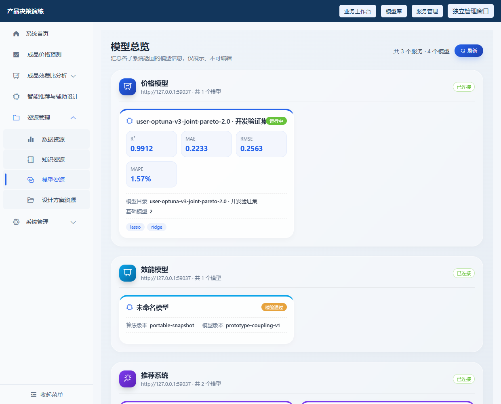
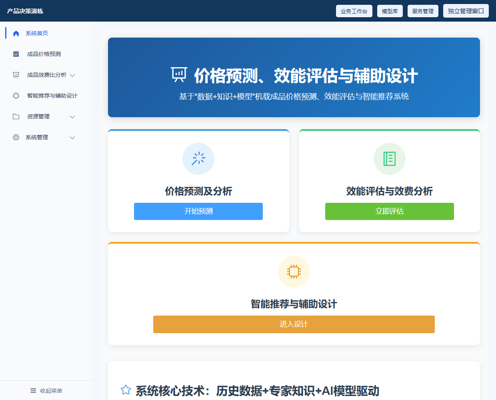
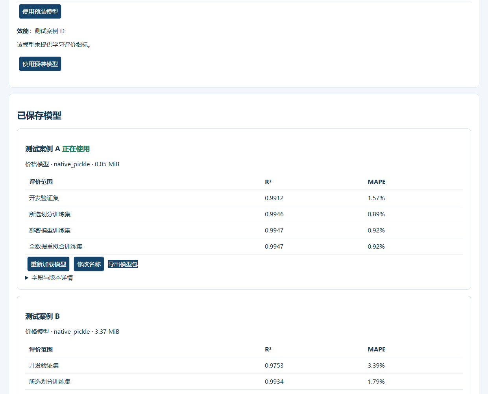

# R11 界面与模型案例验收 · 2026-11-11

应用代码：6ef9f86817016c477f904180bbbcf37f2f20686a。运行管理版本显示 r11-ui-20261111-r1。测试环境 Windows 11 x64 / CPython 3.8.10 / Chrome，虚拟演示数据。没有 Win7 实机，不能声明 Win7 已验收。

## 用户反馈处理

1. 管理页的占用提示改为独立、全宽、自然换行的提示条，真错误单独展示；服务行设置合理列宽，按钮不逐字换行。实际 EXE 在网页端口被占用情况下验收，1240px 提示正常横向排列，560px 无横向溢出。
2. 模型资源总览与顶部模型库均控制显示精度：R²/MAE/RMSE 最多四位小数，MAPE 两位百分比。原始服务数值、计算和导出未舍入。
3. 启动默认进入用户所示门户首页布局，价格、效能、推荐、效费等页面返回首页也统一进入该页；修正效费页面遗留的固定 17891 地址及新开窗口行为。首页去掉无依据的 95% 精度承诺。
4. 深度分析移除情景方案的页签、界面和前端绑定，只保留敏感性分析；旧书签 #scenario 转入 #sensitivity。批量预测等后端兼容接口保持不变。
5. 曲线样式即时切换：平滑线和带采样点的折线有明确视觉区别，使用相同预测数据，不额外计算或改变价格。修改参数后清除旧分析缓存，避免切换样式重新显示旧参数结果。未计算时会提示先运行分析。线性模型的线形可重合，不能为制造弯曲而改数值。
6. 雷达图按统一逐帧数值更新线、填充与节点，取消节点和折线各自的更新补间。实际 EXE 连续五帧检查，每个节点与对应折线顶点误差小于 0.1px；快速输入从当前显示位置继续。雷达图基于产品数值属性，换成少输入的三层模型时仍保持产品属性可对照。
7. 增加直接可用的 A/B/C/D 模型案例、完整参数、预期价格、字段定位和中文说明。开发包 examples/model_cases 内与独立案例包是同一组材料，不包含训练构建临时目录。

## 三层字段名称对照是什么

这是把系统稳定英文字段对应到对方模型要求的参数名称。例如本案例：category_00 → 部件型号，integer_00 → 部件数量，numeric_00 → 尺寸加工量。它不训练模型，也不改业务数据。已封装 C_three_layer_ready.json 内置对应关系，直接导入无需填写。

仅想测试原始 SDK 导入时，才选 C_raw_model_optional.json，并将 C_raw_field_mapping_optional.json 复制到高级对照栏。它与预封装 C 的模型价格一致，已用相同业务参数作模块核对。普通使用推荐预封装文件。

## 怎么测试模型

先退出旧版管理页中的后台软件，再运行新版；只关浏览器不会退出单例进程。确认版本为 r11-ui-20261111-r1，避免继续复用旧后台。

先解压模型案例总包，不要把总包直接上传。在 Portal 顶部“模型库”导入内部 A/B ZIP、C JSON 或 D JSON，检查保存后切换。A/B/C 选择价格模型，D 选择效能模型。

每次切换后刷新深度价格页面，选择 SYN-001，把 numeric_00（演示中文名见案例说明）改为 42.51855，其他属性用成品默认值，再预测：A 16.9574、B 21.6669、C 28.8504 万元。选中成品而未改属性时显示历史成交价，这是既定行为，不能用它判断是否切换模型。

A 是现用 V3；B 基于修改后的虚拟价格用 V3 重新训练；C 只用三个字段演示三层计价，不借用模板旧验证指标，没有 AutoML 学习指标；D 是试用效能接入例，不是正式 V13 专家包。均非甲方业务精度认证。

## 验证结果

实际冻结 EXE 浏览器 27 项检查通过，含四个页面返回首页、两个模型视图精度、样式切换前后数据相等、点线逐帧坐标、四案例界面导入/激活及价格核对。模型 A/B/C 纯预测误差小于 1e-8；关闭重开后 A/D 选择保持，配置 SHA 未变化。端口占用回退仍有效。

桌面 36 项、端口 5 项、分析回归 18 项、综合价格接口 20 项通过。最终开发包实际解压并校验 5194 个文件，清空 PATH 后依赖和输入检查通过，V3、DS 重新封装均生成可运行 EXE，模型未重训。运行 ZIP 的清单、CRC 与无 Python 业务源码审计通过。

| 本地交付文件 | 字节数 | SHA256 |
| --- | ---: | --- |
| PipelinePer_R11A_AutoML_20261111.zip | 71298479 | `659ffbc405b935a45915d9bd14bae6397b348335d9a3f1b871f23c72cc930d27` |
| PipelinePer_R11A_DS_20261111.zip | 71216816 | `cfd0472c3ced4da2d281578d5890791361392904a275ab2e1d18b10d5756408c` |
| CB11B.7z | 82162125 | `46ebb4d1d3e653a0448f36b699aafd20d621f0f9a89443ea8f689d65dab209b3` |
| R11_ModelCases_20261111.zip | 1173168 | `3a08dff073809203994139bb229a92113945b9bc3b229a527d2672f61e08b83a` |

开发包请使用 7-Zip 解压到 C:\，得到 C:\CB11B 后先运行 CHECK_ENVIRONMENT.bat。深路径会触发 Win7 DLL 路径保护；本轮也验证了该保护，并改短路径完成验收。运行 ZIP 必须完整解压并保留必要 DLL、模型和配置。

## 实际截图

完整记录见 [审计清单](audit/r11_20261111/manifest.json)。交付压缩包与模型不上传 GitHub；只推送源码和审计资料，main 不合并。正式甲方模型与 Win7 SP1 x64 仍需现场验证。
