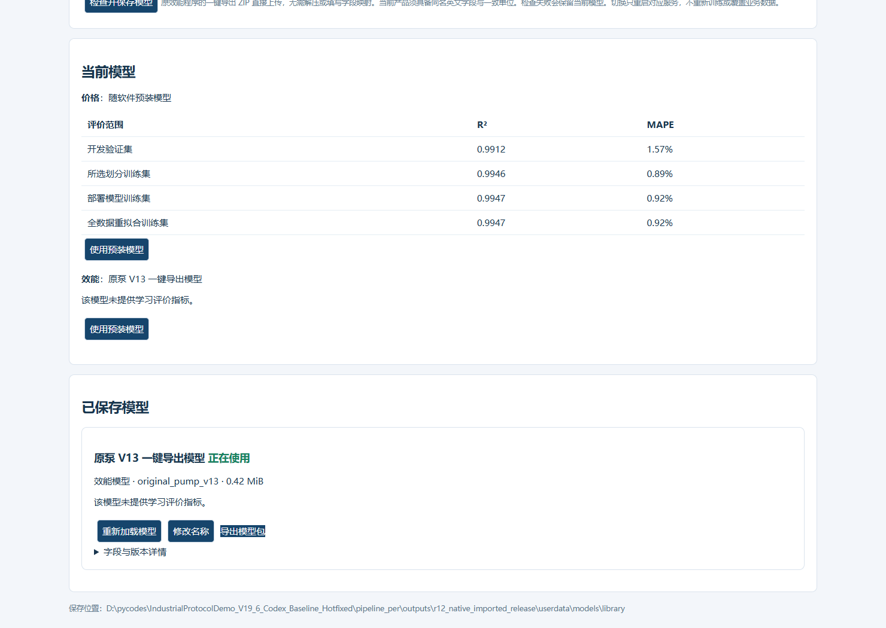
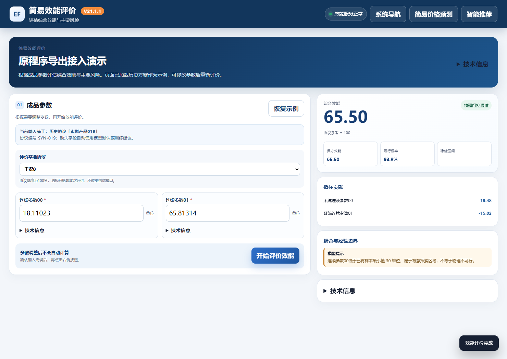

# R12 原效能一键导出包接入 · 2026-11-11

应用代码 d1be837db408b4df934c0b3179a7b953b712f7b3，版本 r12-expert-20261111-r1。用户没有现成模型 ZIP，本轮按授权使用附件中泵 V13 原程序生成虚拟测试包；非甲方正式模型精度验收。

## 现在支持的加载形式

模型库选择“效能模型（原导出包 / 快照）”，直接上传原一键冻结导出的完整 ZIP，不需要解压、不需要手动改 JSON、不需要重新训练。识别附件同版本泵 V13 系统级冻结包、锁 V17 复用模型冻结包、成品 V15 冻结包，以及原有试用快照 JSON。主要整机验收为用户指定的泵 V13；锁 V17 做了原导出方法与冻结接口模块核对。

泵包格式 system-effectiveness-frozen-runtime-package-13.0，清单 system_effectiveness_runtime_manifest.json，模型 model/frozen_system_model.json。原程序原样导出 ZIP 本身带 source/*.py；本软件核对清单 SHA、模型摘要、算法版本和内置运行器的源文件哈希，只安装模型数据，既不保存也不执行上传的 Python 源码。未知专家代码版本会拒绝，不能冒用当前算法加载。

运行软件包没有可读 Python 业务源码。原导出测试 ZIP 单独提供作模型输入资料，不放进软件运行目录。模型库再次导出的资产 ZIP 为 model.json 数据包，可在同软件版本再次导入。

## 保留原专家算法和价格环境

19 份专家算法文件与附件逐字节一致，有原始 SHA 对照。仅增加导出格式识别、参数/结果适配与原运行器加载，不替换专家公式、不修改学习规则。

原专家要求 NumPy 1.24 / SciPy 1.10，价格已有模型要求旧环境。本轮以 expert/effect_worker.exe 隔离封装专家环境（Python3.8.10、NumPy1.24.4、SciPy1.10.1、openpyxl3.1.5）；价格保留 NumPy1.19.5、SciPy1.5.4。用户仍只启动 product.exe，仍是价格、效能、网页三个受监督服务。切换/停止/崩溃恢复与端口自动回退沿用统一管理。

修复工作台原 V10 兼容逻辑静默丢弃已导出工况的问题：原包内任务/基准可选择，不能当作任意新协议重训练。泵系统级效能使用原 system_assessment.total_score，不误用内嵌成品级分数或区间。保留 raw_expert_result 供核对。

锁 V17 原算法只评价效能/复用，不提供物理可行性；接口保留未提供，界面不捏造 0% 或 100%，也不误标物理门控失败。

## 原程序测试与整机结果

通过原 SystemProjectApp 读取虚拟工作簿、初始化有效专家先验状态，并调用其 export_frozen_model_bundle 原方法生成测试 ZIP。测试模型来自可导出的初始先验状态，不表示充分专家学习或正式泵性能。对两工况、三组参数的六组结果，原在线程序、原冻结运行器、HTTP 工作台、推荐评价接口一致，误差小于 1e-6。

完整导入演示 EXE 30 项检查通过：实际浏览器选择原 ZIP、检查保存、切换；仅效能 PID 变化，价格和网页 PID 不变；源文件未装入模型目录，模型可再次导出纯数据，六组评分一致，价格预测保持，重启保留选择并能切回原试用快照。

预置原包的软件 23 项检查通过，开箱即为原泵 V13 后端；两工况评分一致、重启加载及价格不变通过。7 项原包/实际专家 EXE 测试、36 项桌面边界、20 项综合价格分析、11 项元数据与模型库回归通过。损坏清单、改算法后重算清单、路径穿越均拒绝。

最终运行 7z 与开发 7z 均通过完整解压校验。运行包解压到新目录后，另用独立用户目录再次启动真实 EXE，23 项评分、价格一致性及冷启动检查通过（relocated.json）。

最终开发压缩包实际解压校验 5402 个文件，清空外部 PATH/Python 环境后，价格依赖检查、配置原 ZIP 的 REPACK_LAST、实际 EXE 推荐/深度/简易预测一致性通过，价格发布模型文件未变化。

## 甲方训练与封装

原效能程序先完成自己的专家学习并一键导出。新开发包 settings/project.json 中配置：

```json
"effectiveness_package": "input/pump_export.zip"
```

把原 ZIP 放到该路径，按原流程 BUILD_AND_PACKAGE；已有本开发包的成功价格发布记录时 REPACK_LAST 可复用价格模型。原包会校验、用独立专家 EXE 试载，再预置纯模型数据到最终软件。留空则保持试用快照。当前产品必须具备原包要求的英文字段和一致单位，中文显示名不必一致；不能把不同产品模型强套到缺字段数据上。

模型库导入的模型与当前选择保存在独立用户目录，重启/升级保留，不需要重新封装才能切换。

## 本地文件

| 文件 | 字节数 | SHA256 |
| --- | ---: | --- |
| PipelinePer_R12A_PumpExport_20261111.7z | 54233920 | `772c074809f3ef851671b6c0163a225f08ae2926d71d0ec0acfbb24e7f4036c2` |
| PumpV13_OriginalExport_Demo_20261111.zip | 233916 | `3120fc7e010195328dda6d8d0df920f2c688e20003e02b0b7a4cc47407736e05` |
| CB12.7z | 74510989 | `c3937ec824cd86860d4e84eca10398cf3cf8e6bfe0bbb4a011192faae9a6f778` |

使用 7-Zip 完整解压运行包，先在旧版管理页“退出软件”，再启动 product.exe。演示软件已预置同一原包，也可在模型库再次导入它作测试。原 ZIP 与数据说明为虚拟示例，不代表真实甲方模型。





Win11 实际 EXE 验收通过；Win7 SP1 x64、正式客户训练模型与代码签名仍待目标机/业务验收。依赖按原专家要求封装不等于 Win7 已验收。完整记录见 [manifest.json](audit/r12_20261111/manifest.json)。本轮已清理重复冻结环境、解压验收副本和中间压缩包 6,166,462,528 字节（约 6.17 GB），清单见 cleanup.json；保留最终交付物、原始开发环境和用户数据。交付软件、原模型 ZIP 和开发包只保存在本地；main 不合并。
