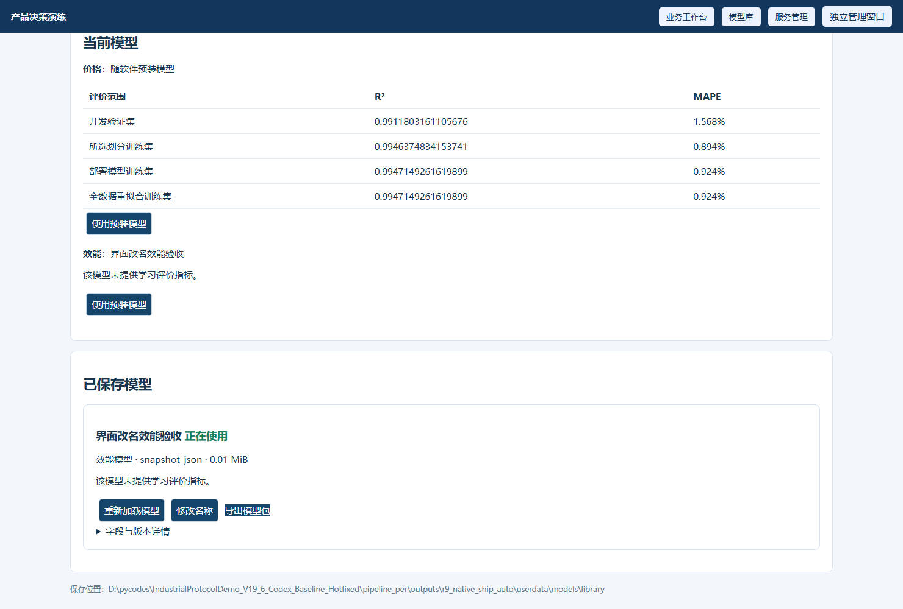
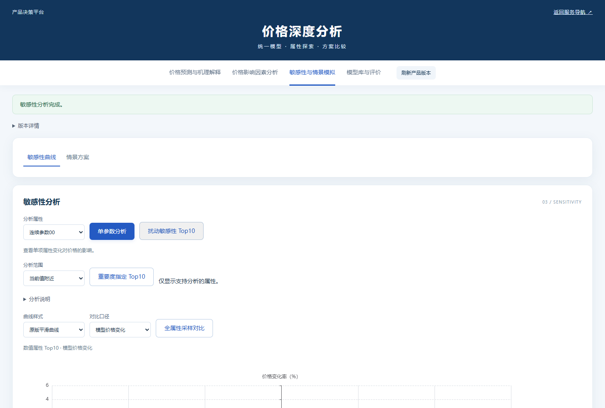

# R9 交付与验收记录 · 2026-11-10

应用代码提交：`2c9ec508404981765fa580389a3974ea04e6de95`。本轮在 Windows 11 x64、CPython 3.8.10 和 Chrome 上实际执行；没有 Win7 实机，也没有甲方正式数据。本轮未上传交付文件，未合并 main。

## 交付文件

| 文件 | 字节数 | SHA256 |
| --- | ---: | --- |
| CB9S.7z | 80998349 | `f8a56972951372eeb16d5154b0c0aca9558e0d33ffeebfea233101b815510fba` |
| PipelinePer_R9C_AutoML_20261110.zip | 71298554 | `9cdc35e81e01c433121b5b058af3dccb9f5e64225ad87aaa7703ee0e8c2f8c07` |
| PipelinePer_R9C_DS_20261110.zip | 71216897 | `1f7f352c031437dfb0ab70964ca5f248a27d263288e31c0d636a1efbd5c2094f` |

开发包为离线训练与封装包，包含源码和依赖。使用 7-Zip 完整解压到 `C:\`，得到 `C:\CB9S`，先运行 `CHECK_ENVIRONMENT.bat` 和 `CHECK_INPUT.bat`；替换 `input/products.xlsx`，按需配置 `settings/project.json`、`settings/v3.json`、`settings/desktop.json`，再执行 `BUILD_AND_PACKAGE.bat`。产品名称优先读取工作簿“产品信息”表，产品编码在 project.json 设置。三层模型选 ds_three_layer 并配置 settings/ds.json，只导入现成模型。

运行 ZIP 必须完整解压，双击 product.exe；必要 DLL 和模型资产须一并保留。运行包没有 Python 业务源码、payload/project 开发目录、独立 python.exe 或 BAT 入口。网页资源冻结在 EXE 中。两份运行包都附虚拟演示模型，不能当作甲方正式模型。

## 本轮修改

1. 启动以现存 SQLite 为准。中文名、旧发布快照差异不再触发原生迁移弹框；差异记入日志，不自动重写、重导业务数据。真实数据库损坏或安装包文件校验失败仍会报错。模型服务异常时可打开网页管理入口。
2. 管理中心编辑已有指标只提交修改的列，后端使用局部 UPDATE，保留类型、枚举映射、必填等设置；新增指标继续提交完整默认值。深度分析兼容 PAR- 自动标识和旧 text/float/numeric 类型。
3. 显示名称从当前数据库覆盖，价格、深度价格、效能和效费响应共用此逻辑；已打开页面同步名称并保留输入。模型内部英文字段和预测数值不变。模型提醒字符串中的名称也通过字段 ID 对应的标签更新，已验证实际越界提醒。
4. 顶部颜色统一为 #12365c，去除软件中的“工业…系统”品牌文案。返回系统导航使用顶层导航，实际嵌套推荐页面已验证不再套 Portal。
5. 推荐分页结果补齐范围元数据，缓存卡片直接打开也能显示 DataMaster、模型生成建议和训练观测范围；正常范围可查看，枚举训练编码不作为连续业务范围比较。不额外调用预测模型。
6. Portal 和模型库显示已发布模型实际提供的指标、单位和评价范围。开发验证、所选划分训练、全数据重拟合训练分开显示；未提供指标不填造值。
7. V3 联合目标是最大化 min(训练 R², 开发验证 R²)，最小化 max(训练 MAPE, 开发验证 MAPE)。两个集均满足阈值才算达标；日志和 CSV 保留各集真实指标。旧版仅验证评分的历史只复用参数、重新计算，新联合目标历史才复用评分。这里的“后者”是日志中的开发验证集；独立测试集不参与调参。不能保证任意数据都能达标。
8. 增加持久模型库：兼容的价格原生 PKL/单模型 ZIP、DS JSON（含字段映射）、效能快照 JSON 可检查、保存、命名、启用与导出。切换独立重启对应服务，失败回滚。保存于独立用户目录 models/library 和 config/active_models.json，升级、重启保留，并纳入备份文件清单。不是任意 pickle 的通用执行器；正式 V13 专家包仍需匹配冻结适配器，尚未作为本轮正式模型验收。
9. 深度分析选中的成品属性完全未改时返回数据库历史成交价，修改后调用模型；标明来源并支持导出。敏感性、情景和纯预测 API 保持模型计算，历史价格不混入模型曲线。
10. 恢复雷达图更新动效与平滑曲线，数值 Top10 用相对扰动横轴；保留原始折线、全属性对比和明确标注的专家加权辅助口径。表格和导出保存真实模型价格。

## 实际验证

| 源代码回归文件 | 用例数 / 全通过 |
| --- | ---: |
| product_desktop_test | 36 |
| product_optuna_v3_test | 20 |
| product_optuna_v3_failure_test | 7 |
| deep_price_contract_test | 13 |
| deep_price_comprehensive_test | 20 |
| deep_price_review_test | 8 |
| price_evaluation_metadata_test | 3 |
| workbook_expert_v3_test | 5 |
| portable_compatibility_test | 18 |
| r6_analysis_test | 18 |
| live_metadata_models_test | 11 |

另有完整旧流水线 45 项通过。最终 AutoML EXE 17 项、DS EXE 17 项通过；实际浏览器 37 项通过，包含 UI 改名、全页面标签同步、模型库文件选择/导入/启用/改名、新增指标默认值、历史价格、曲线和嵌套导航。改名、新增与发布快照差异后，同目录冷启动成功，数据库哨兵记录保留。

160 行、60 属性虚拟表的推荐三次浏览器耗时为 0.729, 0.655, 0.692 秒；数值属性 Top10 为 8.890 秒。这是本机软件性能基线，不代表甲方硬件或正式业务精度。

最终 EXE 内的 V3/DS 互换 5 项通过：原 DS 4.5 万元、切换实际训练 V3 后与原生预测一致、导入修改后的 DS 得 4.6 万元，再切回 V3 并重启保持一致。效能导入和独立重启、错误模型保留当前选择、模型库跨冷启动保存、价格停用时网页仍启动均已验证。

最终开发压缩包经实际解压，5183 个不可变文件 SHA 全匹配；清空 PATH、移除外部 Python 环境变量后，环境/输入检查和 V3、DS 两条 REPACK_LAST 流程通过，生成 EXE 的推荐/简易/深度纯模型预测一致，模型文件未变化。完整 40 次 V3 训练和 DS 导入已在本轮相同训练代码上另行完成，记录见 full_training_kit.json；最终压缩包复验复用了已验证的模型，不重复训练。

运行 ZIP 已验证 CRC、全部清单 SHA 和无 Python 业务源文件。原有用户的 README 修改和本地交付偏好记录保留。仅清理本轮生成的中间冻结目录、重复解压和过期包，清理清单单独保存。

## 截图与证据

全部数值检查、源代码测试记录、冻结引擎元数据和最终包校验见 [审计目录](audit/r9_20261110/manifest.json)。

## 验收边界

Win7 SP1 x64 仍待实机：先检查包内 Python/数值 DLL，再验证 EXE 引导器、浏览器和 Job 进程监督。目标检查入口为 product.exe --target-check --report target-report.json。当前不是已验收的正式 Win7 发行版，未完成代码签名。虚拟数据通过不证明甲方业务准确率；正式模型和正式专家效能仍需使用相应数据与资产验收。
