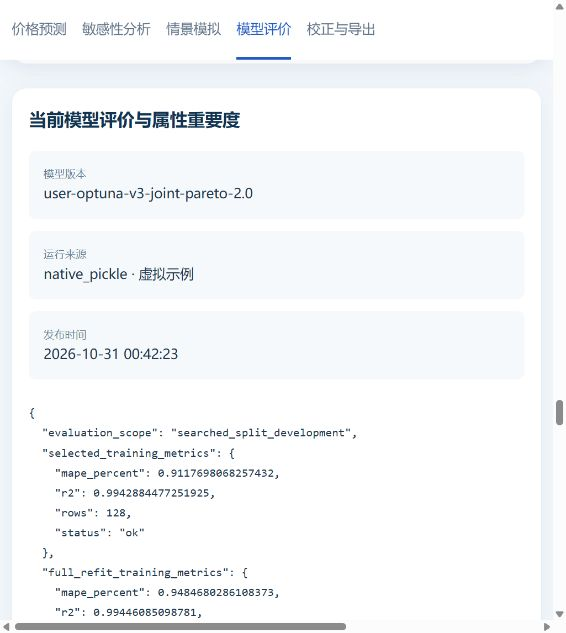

# Optuna V3 原生模型全链路验收（用户授权的虚拟数据）

用户明确允许自行构建虚拟表。本轮验收的是**真实执行V3训练产生的原生模型**，数据仍为合成数据；不是此前的常数/线性测试桩，也不是正式业务精度认证。未改页面、V3搜索/拟合算法、推荐排序、混合定价或EXE封装。main保持未合并。

## A. 数据、训练与模型发布包

- 确定性160条产品、60属性，覆盖连续量、整数、二值配置和中文枚举；双行中文/英文表头、price_wan。种子20261031。源表、配置和provenance在[audit/v3_20261031](audit/v3_20261031/)。
- tools/build_v3_release.py调用原有automl_pipeline入口并显式optuna_v3，避免嵌入式Python的_pth误选旧工作目录。40轮快速验证、600秒上限、关闭自动历史复用、full_data重拟合；实际40轮完成约36秒。原有300轮默认配置没有被改写。
- 六个模型族均参与搜索，最优模型实际保留lasso/ridge两成员；没有为了称作“六模型”篡改融合权重。另构建selected_split变体，用于真实模型替换测试。
- 原V3拒绝缺失数值训练特征。本轮保留其行为，训练表保持完整；推理缺失值负例验证400，不增加隐式填充算法。
- 模型、源表、原始配置、训练报告、业务发布包、试用效能及模型评价旁挂文件打成deliverables/V3_synthetic_acceptance_20261031.zip，内含MODEL_PACKAGE_SHA256.json。它是模型/业务资产包，不含EXE或Python运行时，不是Win7发行认证。

## B. 接口、指标与一致性

现有价格服务以native_pickle、exact_mode=true加载新模型；隔离SQLite导入/激活该模型对应业务包。推荐系统、简易工作台和深度接口对5个产品的原始价格最大差为0。模型和原业务资产SHA在验收后保持不变；运行workspace不需要训练products.xlsx。

原训练算法与导出原生包的最大等价差约4.99e-7万元，通过原构建器1e-5阈值；这是与上述三入口共享HTTP服务差为0不同的检查，不能混为1e-8的同一断言。

旧V3包并未把所有训练指标放入pickle。新增可选--evaluation-metadata：由实际training_report.json生成旁挂JSON，绑定price_model_sha256和source_training_report_sha256，不改模型权重。模型SHA不匹配或缺少来源则拒绝加载。保留selected_training_metrics、full_refit_training_metrics、validation_metrics、validation_protocol和deployment_scope原名，不冒充独立测试指标。无真实feature_importance时仍明确暂无，默认专家属性评分单独标注。

## C. 实际浏览器操作

本机18893隔离环境实际从Portal进入深度页，读取160产品/60控件；修改数值，执行原生预测、单参数曲线、Top10、多属性情景、查看绑定的真实指标并实际下载CSV。

| 情景 | 原始API/CSV价格（万元） | 既有界面四位小数 |
|---|---:|---:|
| numeric_00=50，高配 | 17.535699 | 17.5357 |
| numeric_00=70，基础 | 17.262836 | 17.2628 |

CSV原值重放到相同HTTP价格服务一致，误差<1e-8；界面维持既有四位小数显示，不把格式化文本与六位原值直接比较。见browser_price_consistency.json及实际CSV、01至06截图。



## D. 性能、替换与稳定性

本机Python3.8.10/NumPy1.19.5/sklearn0.24.2环境，Windows宿主10.0.26200；原始版本记录与观察锁文件在runtime_versions.json、runtime-observed.lock.txt。

| 产物/工作负载 | 实测 |
|---|---|
| 新训练60属性、实际2成员模型，单次 | 约0.06–0.14秒 |
| 同模型初测（整数Schema修正前，仅保留过程记录） | 5.593 / 5.610 / 5.047秒 |
| 同模型生命周期复测Top10 | 最终整数约束口径：4.500 / 4.578 / 4.438秒 |
| 历史六成员、36属性V3模拟构建Top10 | 初测14.375 / 14.109 / 14.078秒；最终契约复测12.906秒 |

两个模型/数据规模不同，不能据此做等负载模型速度排名，也不能代表正式业务或Win7速度。两种已测负载均低于原30秒预算，因此本轮未放宽超时或增加异步任务。

真实重新加载同一模型启动新HTTP服务实例、切换到同表selected_split模型服务、再切回原服务：旧身份409，新身份可预测，恢复后原请求可用。首批完成后切到另一真实V3模型的Top10整次返回409且无部分曲线；不可用503及恢复也通过。没有通过直接改UUID来代替上述生命周期检查。详见native_v3_lifecycle_acceptance.json。

预检中发现浮点采样端点可能超出合法小数边界1 ULP，导致旧六成员包x28返回400。已将生成点钳制在原区间内，未放宽业务输入校验，增加500组随机小数区间回归。另保留业务search_type=integer，拒绝小数部件数量并采用整数采样；上述最终口径按350点、4批完成。

公共HTTP层只安静处理已知peer-disconnect错误（写响应和请求分发前），不二次向已断客户端写500；权限/应用等其他错误仍可见。新增5项断连测试、3项指标绑定测试均通过；既有审阅8项、综合20项、兼容18项、价格导出、Portal及完整45项流水线检查也通过，见regression_report.json与对应输出。

## 复现与下一阶段

```powershell
<Python3.8> tools/prepare_v3_acceptance_input.py --output outputs/new_v3_input
<Python3.8> tools/build_v3_release.py --input outputs/new_v3_input/products.xlsx --config outputs/new_v3_input/v3_config.json --output outputs/new_v3_build --product-code SYNTHETIC_V3_ACCEPTANCE --product-name 虚拟V3验收 --virtual-data
<Python3.8> tools/verify_v3_release.py --build-dir outputs/new_v3_build --output outputs/new_v3_check --classification synthetic --repeats 3
<Python3.8> tools/serve_v3_acceptance.py --build-dir outputs/new_v3_build --workspace outputs/new_v3_check/workspace --classification synthetic --port 18893
```

工具默认不认定正式数据；formal分类会拒绝virtual_data=true的构建。报告formal_acceptance始终false，实际API检查与业务/浏览器/目标机认证分开。没有删除训练源文件或改动原构建包来“证明”离线，仅验证隔离runtime workspace不包含训练表且服务使用已发布模型。

本轮形成了进入product.exe原型阶段的真实训练/原生推理基础。真实业务数据精度、正式规则、Win7、持久化目录、进程监督与EXE仍是后续独立验收项。
